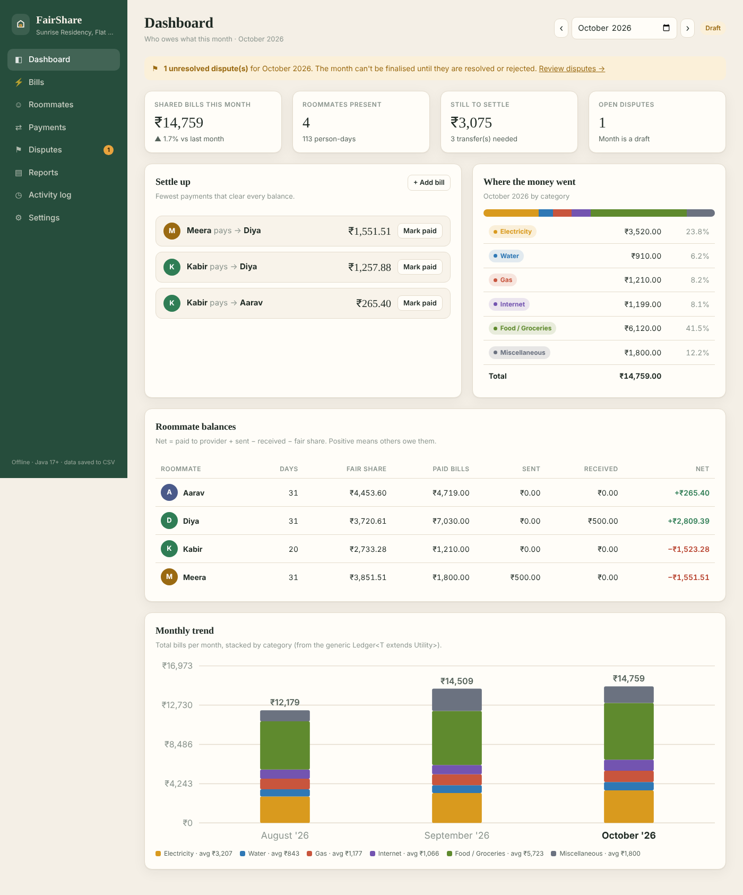
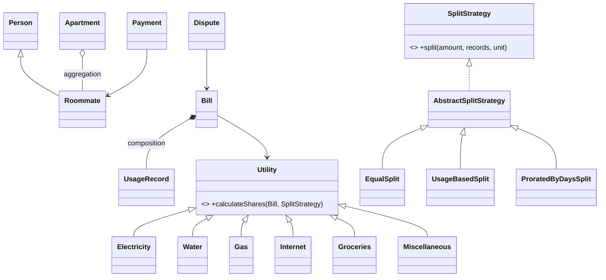

# Shared Apartment Utility & Dispute Resolver

A Java application that splits shared monthly bills (electricity, water, gas, internet, food/groceries and miscellaneous expenses) fairly between roommates, works out who owes whom, keeps a record of payments and disputes, and exports a monthly settlement report.

*Object-Oriented Programming mini project, implemented in Java 17 with **no external libraries**.*



---

## Features

| Feature | What it does |
|---|---|
| **Roommates and occupancy** | Each roommate has a move-in and an optional move-out date. Days present in each month are calculated automatically. |
| **Six bill categories** | Electricity, Water, Gas, Internet, Food / Groceries and Miscellaneous, each a subclass of the abstract `Utility` class. |
| **Three fair split rules** | *Equal*, *Usage-based* (by meter units) and *Prorated by days*. Each category has a sensible default (groceries by days present, miscellaneous equally). |
| **Two-part electricity tariff** | The fixed/meter charge is shared by days present. The energy charge is split by kWh used. |
| **Live preview** | While you add a bill, every share is recalculated as you type. |
| **Auditable splits** | Every share shows its formula, e.g. `260 of 615 kWh (42.3%) x ₹3,220.00`. |
| **Settle up** | A greedy algorithm suggests the fewest payments needed to clear every balance. *Mark paid* records them in one click. |
| **Disputes** | Raise a dispute on a bill, then *Start review*, *Resolve* or *Reject* it. A resolution note is required. |
| **Month finalisation** | Locks a month's bills and payments. This is **blocked while any dispute is unresolved** (`UnresolvedDisputeException`). |
| **Reports** | `reports/settlement_YYYY-MM.txt` (readable) and `.csv` (opens in Excel), plus in-browser download. |
| **Activity log** | Every change is appended to `data/audit.log` with a timestamp. |
| **Trends** | Stacked monthly chart and per-utility averages, built from the generic `Ledger<T extends Utility>`. |
| **Offline and portable** | Data is stored as plain CSV files. Runs on any laptop with Java 17 or later. |

---

## How to run

**Requirements:** JDK 17 or newer (`java -version`). Nothing else is needed.

### Option A: run the ready-made jar
```bash
java -jar UtilityDisputeResolver.jar
```
The app opens in your browser at **http://localhost:8080** (if 8080 is busy it tries 8081, 8082 and so on). On Windows you can also double-click **`run.bat`**.

On the first screen, click **Load sample data** to get 4 roommates and 3 months of bills (Aug–Oct 2026), including one move-in, one move-out and two disputes.

### Option B: build from source
```bash
./build.sh        # Windows: build.bat
java -jar UtilityDisputeResolver.jar
```

### Run the tests
```bash
./test.sh         # Windows: test.bat
```
There are 18 tests: unit tests for every split rule, the exceptions and the generics, plus an integration test that loads the demo, settles up, finalises, checks the lock and reloads everything from the CSV files.

### Open in an IDE (IntelliJ / Eclipse / VS Code)
Open the folder, mark `src/main/java` as the sources root and `src/main/resources` as the resources root, then run `com.utilityresolver.main.App`.

---

## OOP concepts: where to find them

| Concept | Where in the code |
|---|---|
| **Classes and objects** | `model/` – `Apartment`, `Roommate`, `Bill`, `UsageRecord`, `Payment`, `Dispute`, `Share`, `Transfer` |
| **Constructors** | Validating constructors, e.g. `Roommate(...)`, `Bill(...)`, `UsageRecord(...)`. Overloaded constructors in `Roommate` and `Dispute`. |
| **Encapsulation** | Private fields with validated setters (`Person.setEmail`). `Apartment.getRoommates()` returns an unmodifiable list. |
| **Inheritance** | `Person` → `Roommate`. `Utility` → `Electricity`, `Water`, `Gas`, `Internet`, `Groceries`, `Miscellaneous`. `AbstractSplitStrategy` → 3 strategies. `AppException` → 6 custom exceptions. |
| **Polymorphism** | `Utility.calculateShares()` is **overridden** in `Electricity` (two-part tariff) and `Gas` (fallback for cylinders); `validate()` is overridden in `Miscellaneous` (a description is required). `getRole()`, `isMetered()` and `getDefaultStrategy()` are overridden in each subclass. `SplitStrategy` objects are called through the interface. |
| **Abstraction** | Abstract classes `Person`, `Utility` and `AbstractSplitStrategy` (template method `split()` → abstract `computeShares()`). |
| **Interfaces** | `SplitStrategy`, `Identifiable`, `Repository<T>`, `CsvMapper<T>`, plus `HttpHandler` (JDK) |
| **Association / Aggregation / Composition** | *Association:* `Payment` → 2 `Roommate`s, `Dispute` → `Bill`. *Aggregation:* `Apartment` o– `Roommate`. *Composition:* `Bill` *– `UsageRecord` (created by `Bill.addUsage`). |
| **Exception handling** | `exception/` – `NegativeUsageException`, `UnresolvedDisputeException`, `InvalidBillException`, `MonthLockedException`, `EntityNotFoundException`, `ValidationException`. `ApiHandler` maps each one to an HTTP status. |
| **File handling** | `storage/CsvRepository` (read/write CSV with a safe temp-file swap), `DataStore` (`.properties`, `.txt`), `AuditLogger` (append mode), `ReportService.export()` (TXT + CSV reports) |
| **Collections** | `List`, `LinkedHashMap`, `TreeMap`/`SortedMap`, `TreeSet`, `EnumMap`, streams, `Comparator` |
| **Generics** | `Ledger<T extends Utility>`, `Repository<T extends Identifiable>`, `CsvRepository<T>`, `CsvMapper<T>`, generic method `<T extends Utility> Ledger<T> buildLedger(T)` |
| **Packages** | `main`, `model`, `model.utility`, `strategy`, `service`, `exception`, `util`, `storage`, `web` |
| **Design patterns (bonus)** | Strategy (`SplitStrategy`), Factory (`UtilityType.create()`, `StrategyFactory`), Template Method (`AbstractSplitStrategy`), Repository, Facade (`AppContext`) |

---

## UML

* [Domain model class diagram](docs/uml/1-domain-model.png) ([Mermaid source](docs/uml/1-domain-model.mmd))
* [Architecture / layers class diagram](docs/uml/2-architecture.png)
* [Sequence diagram: finalising a month](docs/uml/3-finalise-sequence.png)

GitHub renders the diagrams below directly:



---

## Project structure

```
src/main/java/com/utilityresolver/
├── main/        App.java – entry point, starts the server and opens the browser
├── model/       Person, Roommate, Apartment, Bill, UsageRecord, Payment, Dispute, ...
│   └── utility/ Utility (abstract), Electricity, Water, Gas, Internet, Groceries, Miscellaneous, UtilityType
├── strategy/    SplitStrategy (interface), AbstractSplitStrategy, Equal/UsageBased/ProratedByDays, StrategyFactory
├── service/     AppContext, RoommateService, BillingService, PaymentService, DisputeService,
│                PeriodService, SettlementService, ReportService, DemoDataService
├── exception/   AppException + 6 custom exceptions
├── storage/     Repository<T>, CsvRepository<T>, CsvMapper<T>, Mappers, DataStore
├── util/        Ledger<T>, Money, CsvUtil, Json, IdGenerator, AuditLogger
└── web/         WebServer, ApiHandler (REST JSON API), StaticFileHandler, JsonMapper, Request
src/main/resources/web/   index.html, styles.css, app.js (front end)
src/test/java/            AllTests.java (18 tests)
docs/uml/                 class + sequence diagrams (Mermaid, PNG, SVG)
data/      (created at runtime) roommates.csv, bills.csv, payments.csv, disputes.csv, audit.log ...
reports/   (created at runtime) settlement_YYYY-MM.txt / .csv
```

### How the split works (example: October 2026 electricity, ₹3,520 with a ₹300 fixed charge)
1. **Fixed ₹300** is shared by person-days: Kabir moved out on the 20th, so 31 + 31 + 20 + 31 = 113 person-days and Kabir pays 20/113 of it.
2. **Energy ₹3,220** is split by kWh: Aarav used 260 of 615 kWh, so he pays 42.3% of it.
3. Shares are rounded to the paisa, and any leftover paisa goes to the largest share so the total matches the bill exactly.
4. **Net balance** = paid to provider + payments sent − payments received − fair share. Debtors are matched to creditors to produce the "Settle up" list.

---

## REST API (used by the front end)

| Method | Path | Purpose |
|---|---|---|
| GET | `/api/summary?month=2026-10` | Full month settlement (bills, shares, balances, transfers) |
| GET/POST/PUT/DELETE | `/api/roommates[/{id}]` | Manage roommates |
| GET/POST/PUT/DELETE | `/api/bills[/{id}]` | Manage bills |
| POST | `/api/preview` | Calculate shares without saving |
| GET/POST/DELETE | `/api/payments[/{id}]` | Payments between roommates |
| GET/POST | `/api/disputes`, `/api/disputes/{id}/status` | Raise and resolve disputes |
| POST | `/api/period/{month}/finalize` · `/reopen` | Lock or unlock a month |
| GET/POST | `/api/report?month=&format=txt\|csv` | View, download or save a report |
| GET | `/api/trends`, `/api/audit`, `/api/meta` | Charts, activity log, metadata |
